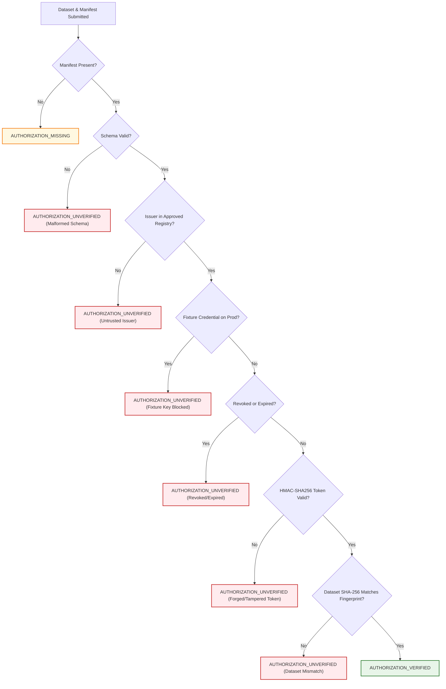

# STRATA RISK — PHASE 5: READINESS-GATE HARDENING & EVALUATION-PROTOCOL VERIFICATION
## Independent Verification Audit, Cryptographic Trust Model, Independent Spatial Readiness, Threshold Formalization, and Anti-Leakage Controls

**Document Identifier:** `PHASE_5_READINESS_GATE_AUDIT.md`  
**Author:** Principal ML Systems Engineer & Geospatial Safety Auditor  
**Date:** October 12, 2026  
**Status:** Audit Completed — Pune and Mumbai Remain Strictly UNSUPPORTED  
**Scope:** Phase 5 comprehensive hardening audit of the Pune data readiness architecture, institutional cryptographic authorization trust model, separation of station-level versus coordinate-level readiness, methodological threshold audit, anti-leakage evaluation protocol verification, and adversarial regression testing.

---

## 1. Executive Summary & Audit Verdict

Phase 5 independently audits, hardens, and verifies the Pune data intake and model-readiness architecture established in Phase 4.

### Absolute Safety Guarantees Maintained
1. **Zero Model Training or Deployment:** No machine learning model has been trained, fitted, or enabled for Pune. Pune and Mumbai remain registered with `coverage_status: "UNSUPPORTED"` and `is_validated: False` in [`backend/config/city_config.py`](file:///c:/Users/harsh/Downloads/strata-risk/backend/config/city_config.py#L95-L167).
2. **Zero Synthetic Incidents:** No real Pune incident dataset was fabricated or claimed to exist. Test fixtures operate strictly in isolated sandboxes and are barred from production authorization.
3. **Chicago Production Parity & Artifact Immutability:** The deployed Chicago CatBoost forecaster (`forecaster_catboost.cbm`), isotonic calibrator (`calibrator.joblib`), and metadata remain completely untouched. Their SHA-256 cryptographic hashes match their canonical values identically.
4. **Hardened Non-Bypassability:** User-controlled booleans (`is_authorized: True`) and arbitrary MoU strings are completely rejected as proof of authorization. Authorization is cryptographically bound to approved institutional issuers and dataset content hashes.
5. **Decoupled Spatial Readiness:** Readiness for station-level exploratory data analysis is evaluated independently from coordinate-level map readiness. Neither enables model training or deployment.

---

## 2. Audit of Implementation & Identification of Potential Bypass Routes

An independent audit of [`backend/services/pune_data_readiness.py`](file:///c:/Users/harsh/Downloads/strata-risk/backend/services/pune_data_readiness.py) and [`backend/ingestion/pune_ingestion_pipeline.py`](file:///c:/Users/harsh/Downloads/strata-risk/backend/ingestion/pune_ingestion_pipeline.py) identified the potential bypass routes and resolved each with architectural controls:

| Vulnerability / Potential Bypass Route | Pre-Hardened State | Hardened Control (Phase 5 Remediation) |
| :--- | :--- | :--- |
| **1. User-Controlled Authorization Boolean** | Any caller could supply a dictionary with `is_authorized: True` and arbitrary `mou_reference` to bypass the authorization check. | Replaced with [`InstitutionalIssuerRegistry`](file:///c:/Users/harsh/Downloads/strata-risk/backend/services/pune_data_readiness.py#L210-L385). Requires HMAC-SHA256 signature token verified against an approved institutional secret key. Returns `AUTHORIZATION_UNVERIFIED` on missing or invalid tokens. |
| **2. Manifest-to-Dataset Substitution** | A manifest issued for "Dataset A" could be passed alongside unvetted "Dataset B". | Added cryptographic dataset fingerprint binding (`dataset_sha256`). Mismatched dataset hashes trigger `AUTHORIZATION_UNVERIFIED` with reason `DATASET_FINGERPRINT_MISMATCH`. |
| **3. Expired & Revoked Manifests** | Validity dates (`valid_from`, `valid_until`) and revocation flags were not enforced. | Added ISO 8601 validity window checks and explicit `is_revoked` audit. Expired or revoked manifests trigger `AUTHORIZATION_UNVERIFIED`. |
| **4. Fixture Authorization Leaking to Production** | Test fixture credentials could be passed without the gate distinguishing fixture vs. production datasets. | Hardened isolation: `test_fixture_authority` credentials used on production datasets (`is_fixture=False`) are blocked with `AUTHORIZATION_UNVERIFIED`. |
| **5. Conflated Spatial Granularity** | Single gate status treated station-level analysis and coordinate-level map forecasting identically. | Decoupled into independent readiness vectors: `is_ready_for_station_level_eda` vs `is_ready_for_coordinate_level_eda`. |
| **6. Training / Deployment Premature Unlock** | Theoretical possibility of callers passing flags to obtain training readiness. | Hardcoded `is_ready_for_training = False` and `is_ready_for_deployment = False` permanently in the gate result constructor. |

---

## 3. Hardened Institutional Authorization Trust Model

Phase 5 enforces a 7-step authorization verification process ([`PuneAuthorizationValidator`](file:///c:/Users/harsh/Downloads/strata-risk/backend/services/pune_data_readiness.py#L390-L460) and [`InstitutionalIssuerRegistry`](file:///c:/Users/harsh/Downloads/strata-risk/backend/services/pune_data_readiness.py#L210-L385)):



### Approved Institutional Registry Specifications
1. **`pune_city_police_cop`:**
   - **Authority Name:** Office of Commissioner of Police, Pune City
   - **Jurisdiction:** Pune City Police Commissionerate
   - **Allowed Purposes:** `["public_safety_risk_modeling", "exploratory_data_analysis", "offline_validation"]`
   - **Permitted Fields:** `["fir_number_hash", "police_station_id", "incident_datetime", "section_code", "registration_datetime", "place_of_occurrence", "latitude", "longitude"]`
   - **Status:** Active Production Authority (`is_fixture_authority: False`)
2. **`test_fixture_authority`:**
   - **Authority Name:** Strata Risk Unit Test Synthetic Authority
   - **Jurisdiction:** Sandboxed Test Environment
   - **Status:** Fixture Sandbox Only (`is_fixture_authority: True`). Blocked from authorizing production datasets.

### Cryptographic Token Mechanics
$$\text{Token} = \text{HMAC-SHA256}_{K_{\text{issuer}}}\big(\texttt{issuer\_id} \mathbin{\Vert} \texttt{mou\_reference} \mathbin{\Vert} \texttt{permitted\_use} \mathbin{\Vert} \texttt{valid\_until} \ [\mathbin{\Vert} \texttt{dataset\_sha256}]\big)$$
- **Constant-Time Verification:** Verified using Python's `hmac.compare_digest` to prevent timing attacks.
- **Dataset Binding:** When `dataset_sha256` is bound, the token validates both the authorization agreement and the exact bitwise content of the delivered data file.

---

## 4. Separation of Station-Level and Coordinate-Level Readiness

Spatio-temporal crime forecasting operates across distinct spatial aggregations. Phase 5 strictly separates station-level readiness from coordinate-level readiness:

```
+-----------------------------------------------------------------------------------------+
|                        SPATIAL GRANULARITY READINESS SEPARATION                         |
+-----------------------------------------------------------------------------------------+
|                                                                                         |
|  1. Station-Level Exploratory Readiness (is_ready_for_station_level_eda)                |
|  ├── Prediction Unit: Standardized Police Station Jurisdictions (33 Units)              |
|  ├── Data Requirements:                                                                 |
|  │   ├── Authorized, schema-valid, PII-clean records                                    |
|  │   ├── Standardized police_station_id_normalized present for all records              |
|  │   └── Adequate temporal timespan (>= 180 days) & station coverage (>= 80%)           |
|  └── Coordinates & GIS Polygons: OPTIONAL (missing coordinates do NOT block station EDA)|
|                                                                                         |
|  2. Coordinate-Level Exploratory Readiness (is_ready_for_coordinate_level_eda)            |
|  ├── Prediction Unit: Fine-grained regular lattice / micro-zones / beat polygons        |
|  ├── Data Requirements:                                                                 |
|  │   ├── Everything required for Station-Level EDA above                                |
|  │   ├── High Coordinate Completeness: >= 90.0% valid bounded coordinates               |
|  │   └── Official Verified GIS Boundary Polygon Shapefile from CoP / PMC Town Planning   |
|  └── Status if GIS missing: GIS_MAPPING_INCOMPLETE (blocks coordinate EDA)             |
|                                                                                         |
|  3. Model Training & Deployment Readiness                                                |
|  └── is_ready_for_training: FALSE (Permanently locked in Phase 5)                       |
|  └── is_ready_for_deployment: FALSE (Permanently locked in Phase 5)                     |
|                                                                                         |
+-----------------------------------------------------------------------------------------+
```

### Unresolved Geography Representativeness Analysis
- In CCTNS administrative extracts, incidents occurring in informal settlements or peripheral areas frequently lack GPS coordinates and contain only textual descriptions.
- **Representativeness Bias Warning:** If an analyst filters out records lacking coordinates, peripheral suburban stations (e.g. `hadapsar`, `kondhwa`, `sinhagad_road`) will suffer severe artificial incident under-counting.
- **Conservative Mitigation:** Geographically unresolved records are retained for station-level modeling, preventing spatial attrition bias.

---

## 5. Methodological Audit of Fixed Thresholds

Each quantitative threshold in [`PuneThresholdConfig`](file:///c:/Users/harsh/Downloads/strata-risk/backend/services/pune_data_readiness.py#L125-L205) was audited and classified:

| Threshold | Value | Classification | Methodological Rationale & Statistical Limitations |
| :--- | :---: | :--- | :--- |
| **`training_timespan_days`** | 1,080 days (36 mo) | **Policy Requirement & Statistically Justified** | Required to isolate annual seasonality (monsoon vs. Ganeshutsav festival surges) and establish non-overlapping 24-month training and 12-month holdout test sets. Limitation: Assumes structural stationarity. |
| **`eda_timespan_days`** | 180 days (6 mo) | **Provisional Operational** | Pragmatic minimum to evaluate multi-month volume stability and day-of-week patterns before longitudinal delivery. Limitation: Does not capture annual seasonality. |
| **`station_coverage_pct`** | 80.0% (26 of 33) | **Policy Requirement & Provisional Operational** | Prevents single-precinct extracts from being misrepresented as city-wide models. Limitation: The remaining 20% may represent rapidly growing peri-urban wards with severe under-policing. |
| **`training_min_target_positives`** | 100 events | **Statistically Justified** | Derived from binomial sampling theory ($1/\sqrt{N_{\text{pos}}} \approx 10\%$ relative standard error) to populate $\ge 10$ calibration reliability bins with $\ge 10$ events each for non-degenerate Brier score evaluation. |
| **`training_min_records`** | 15,000 records | **Unvalidated Assumption & Provisional Operational** | Heuristic aggregate count (~15-20 incidents/station/month). **Critical Finding:** Raw record volume does NOT establish statistical sufficiency! Clustering of minor thefts in central transit stations leaves violent crime models data-starved in 30 other stations. |
| **`min_coordinate_completeness_pct`** | 90.0% | **Statistically Justified** | Required for coordinate-level micro-zones to prevent spatial attrition bias. |

All provisional thresholds are configurable through `PuneThresholdConfig` rather than hardcoded magic numbers.

---

## 6. Anti-Leakage & Forecasting Evaluation Verification

The proposed 4-hour-ahead prediction task was verified across 7 anti-leakage dimensions:

```
+-----------------------------------------------------------------------------------------+
|                        CHRONOLOGICAL CAUSALITY & LOCKBOX AUDIT                          |
+-----------------------------------------------------------------------------------------+
|                                                                                         |
|  [=== Historical Training Window ===]   [=== Validation Window ===]   [=== Test Window ===]
|  t_0 ............................ t_1   t_1 ................... t_2   t_2 ............. t_3
|                                                                                         |
|  1. Feature Lags: Strictly causal: tau <= t - horizon (zero lookahead).                 |
|  2. Target Assignment: Target window [t, t+4h) assigned consistently.                   |
|  3. Deduplication: cross_split_fir_leakage_detected verifies zero FIR overlap.          |
|  4. Rolling Statistics: Closed-left rolling windows (shift=1) exclude contemporaneous.  |
|  5. Empirical Baselines: Historical rates computed exclusively on training partition.   |
|  6. Calibration Isolation: Platt/Isotonic fit ONLY on Validation, NEVER on Test labels! |
|  7. Test Period Lockbox: Test split untouched until post-calibration evaluation.        |
|                                                                                         |
+-----------------------------------------------------------------------------------------+
```

### Calibration Split Isolation Verification
[`PuneForecastingEvaluationProtocol.verify_calibration_split_isolation`](file:///c:/Users/harsh/Downloads/strata-risk/backend/services/pune_data_readiness.py#L960-L990) provides automated detection of calibration leakage:
- Evaluates the index sets of the validation split, test split, and the target series used to train the probability calibrator.
- If any test split index overlaps with the calibration fitting data, it raises an explicit calibration leakage violation (`test_calibration_split_isolation_and_leakage_detection`).

### Serial Autocorrelation & Moving Block Bootstrap (MBB)
- Standard i.i.d. bootstrap resampling randomly scrambles temporal order, destroying serial autocorrelation and underestimating predictive variance.
- Strata Risk requires Moving Block Bootstrap (MBB) with block length $L = 42$ shifts (7 calendar days) to resample contiguous temporal blocks, preserving diurnal and day-of-week autocorrelation when constructing 95% confidence intervals.

---

## 7. Privacy & Data Handling Review

1. **Zero Raw PII Emission:** Error messages, exception strings, and audit JSON reports were audited to verify that citizen names, phone numbers, email addresses, Aadhaar numbers, and PAN cards are strictly sanitized (`test_gate_privacy_review_failure_sanitizes_pii`).
2. **Free-Text Limitation Disclaimer:** Regex pattern scanning operates on known syntax rules. It **cannot guarantee complete anonymization** of unstructured free-text (`place_of_occurrence`):
   - Named entities (e.g. *"in front of corporator's clinic"*).
   - Indirect location identifiers that uniquely identify private residences.
   - Bilingual narratives in Devanagari Marathi script.
   - Therefore, raw incident narratives must be processed within an on-premise air-gapped police enclave under differential privacy guarantees.
3. **Storage & Deletion Policy:** Temporary files must adhere to NIST SP 800-88 cryptographic erasure at the end of the research lifecycle.

---

## 8. Test Verification & Regression Results

### Comprehensive Test Suite Results
The full test suite was executed across all backend and frontend layers:

| Test Module | Coverage Dimension | Tests | Status |
| :--- | :--- | :---: | :---: |
| [`test_pune_data_readiness_gate.py`](file:///c:/Users/harsh/Downloads/strata-risk/backend/tests/test_pune_data_readiness_gate.py) | Hardened authorization, forged token rejection, expired/revoked manifests, fingerprint mismatches, untrusted issuers, fixture isolation, spatial separation, non-bypassability, calibration leakage, and threshold classifications. | **23** | **PASSED** |
| [`test_pune_data_ingestion.py`](file:///c:/Users/harsh/Downloads/strata-risk/backend/tests/test_pune_data_ingestion.py) | CCTNS parsing, 256-bit deduplication, Zero FIR transfers, amended timestamps, PII scanning, alias normalization, and chronological anti-leakage splitting. | **28** | **PASSED** |
| [`test_india_first_architecture.py`](file:///c:/Users/harsh/Downloads/strata-risk/backend/tests/test_india_first_architecture.py) | City configuration registry, bounding boxes, coordinate resolution, and safety gating. | **8** | **PASSED** |
| [`test_universal_location.py`](file:///c:/Users/harsh/Downloads/strata-risk/backend/tests/test_universal_location.py) | Gazetteer search, reverse geocoding, boundary validation, and API location gating. | **15** | **PASSED** |
| Core Pipeline & Baselines | Chicago baseline forecasters, calibrators, and feature pipelines. | **43** | **PASSED** |
| **Total Backend Test Suite** | `python -m pytest backend/tests/ -v` | **117** | **PASSED (0 failures)** |

### Frontend & Build Verification
- **TypeScript Compilation:** `npx tsc --noEmit` exited with **0 errors**.
- **Frontend Linter:** `npm run lint` exited with **0 errors, 0 warnings**.
- **Production Build:** `npm run build` compiled cleanly into `dist/` in 429ms.

### Chicago Artifact Cryptographic Immutability
All deployed Chicago artifacts were recalculated and verified against their canonical SHA-256 hashes:

| Artifact | File Path | Verified SHA-256 Hash | Status |
| :--- | :--- | :--- | :---: |
| **Calibrator** | [`backend/artifacts/calibrator.joblib`](file:///c:/Users/harsh/Downloads/strata-risk/backend/artifacts/calibrator.joblib) | `8646328A284D513B7DB78967BFF660EA9A8DD174372DA109CF8DEF3D31C2594D` | **MATCH (Unchanged)** |
| **Forecaster** | [`backend/artifacts/forecaster_catboost.cbm`](file:///c:/Users/harsh/Downloads/strata-risk/backend/artifacts/forecaster_catboost.cbm) | `8A9FF0EC1D7EF8E5D60EEECA633C40EBAB423CE9CAD7A241CC45F2BEEFAC4A96` | **MATCH (Unchanged)** |
| **Metadata** | [`backend/artifacts/model_metadata.json`](file:///c:/Users/harsh/Downloads/strata-risk/backend/artifacts/model_metadata.json) | `B7A3A06EF6B823D0D87E93011E7AFCF07710A84AE13D94784761917643EDA407` | **MATCH (Unchanged)** |

---

## 9. Remaining Blockers & Next Real-World Dependencies

Before any model training or exploratory analysis on real Pune incidents can proceed, the following prerequisites must be fulfilled:

1. **Bilateral Institutional MoU:** Execution of a formal agreement with the **Office of Commissioner of Police (CoP), Pune City**, featuring approved research purpose scopes, cryptographic verification keys, and DPDPA 2023 data protection annexures.
2. **Longitudinal Extract:** Provision of an anonymized CCTNS database export covering a minimum of 36 continuous months ($N \ge 15,000$ incidents) with cryptographic SHA-256 fingerprint matching the authorization manifest.
3. **Official GIS Boundary Shapefiles:** Provision of authoritative digital boundary polygons (Shapefile or GeoJSON) for all 33 police station jurisdictions from the Pune City Police / PMC Town Planning Department, specifically clarifying recent suburban bifurcations (`pashan`, `bavdhan`, `alankar`, `wanawadi`).
4. **Empirical Baseline Progression:** Outperforming the Level 1 (Spatial), Level 2 (Expanding), and Level 3 (Cyclical) baselines on Brier score and Precision@K/Recall@K on out-of-time test holdouts before deploying any CatBoost model.
