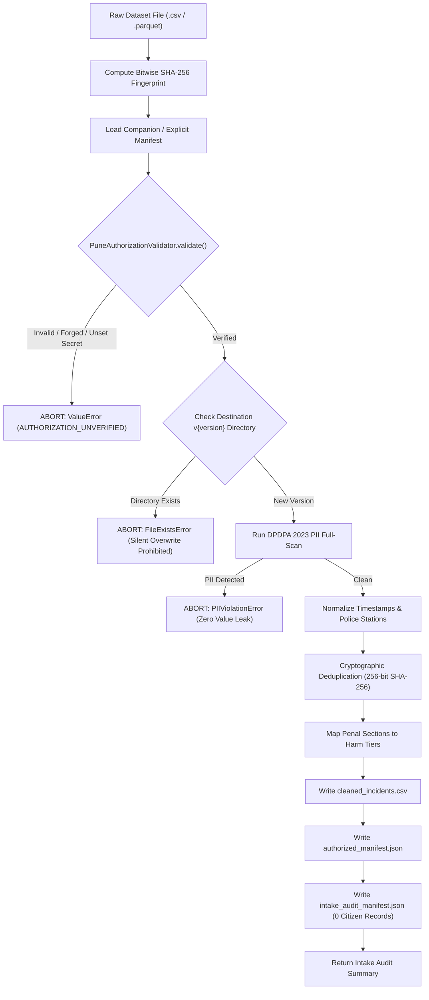

# STRATA RISK — PHASE 6: AUTHORIZED DATA ACQUISITION PREPARATION
## Comprehensive Institutional Preparation, Key Management, Intake Architecture, and Readiness Transition Package

> [!IMPORTANT]
> **OPERATIONAL INVARIANTS CERTIFICATION**
> - **Pune Status**: Strictly `UNSUPPORTED` (`is_validated = False`).
> - **Mumbai Status**: Strictly `UNSUPPORTED` (`is_validated = False`).
> - **Pune Models Trained / Enabled**: **0** (Zero model training or CatBoost fitting conducted).
> - **Fabricated Forecasts**: **0** (No simulated, synthetic, or manufactured Indian forecasts returned).
> - **Chicago Artifacts & Serving Behavior**: **100% Unaltered** (Identical SHA-256 hashes verified).
> - **Institutional Legal Status**: **Draft package only**. No MoU or police data access currently exists.

---

## 1. Executive Summary & Phase 6 Objectives

Phase 6 prepares Strata Risk for the eventual receipt and analysis of an authorized Pune City Police incident dataset. Building upon the 9-stage readiness gate and evaluation protocols established in Phases 4 and 5, Phase 6 achieves:

1. **Secure Institutional Key Management**:
   - Completely eliminated hardcoded production secrets from source code.
   - Decoupled production institutional secret resolution to secure environment variables (`PUNE_COP_HMAC_SECRET`).
   - Hardened verification to block production authorization when the institutional secret is unprovisioned.
   - Enforced cryptographic isolation: test fixture authorities cannot authorize production datasets, and manifests enforcing dataset fingerprint binding require matching SHA-256 hashes.
2. **Institutional Data Request Package**:
   - Created `INSTITUTIONAL_DATA_REQUEST_PACKAGE.md` containing a formal draft request letter to the Commissioner of Police, Pune City, a proposed data dictionary, minimum field specifications, DPDPA 2023 compliance terms, permitted-use boundaries, a 365-day retention schedule, GIS boundary checklist, and institutional approval criteria.
   - Formally designated all documents as drafts requiring bilateral review.
3. **Formalized Reproducible Data Intake Pipeline**:
   - Implemented `PuneDataIngestionPipeline.ingest_authorized_dataset` enforcing cryptographic manifest verification, bitwise SHA-256 fingerprint checking, version immutability (prohibiting silent overwriting of prior versions), automated PII scrubbing, and emission of immutable `intake_audit_manifest.json` containing zero raw citizen-level records.
4. **Reproducible Real-Data EDA CLI**:
   - Built standalone executable CLI `scripts/run_pune_eda.py` that defaults to `NO_DATA` when no path is supplied, requires valid institutional authorization for production inputs, prominently flags fixture runs, produces aggregated metrics, and avoids exporting citizen records.
5. **Formal Lifecycle Readiness Transitions (Stages 0–6)**:
   - Added `PuneLifecycleStage` and `PuneLifecycleTransitionManager` specifying unambiguous transition requirements from Stage 0 (Unauthorized) to Stage 6 (Approved Pilot).
   - Permanently locked Stages 4 (Model Training), 5 (Independent Validation), and 6 (Operational Pilot) as disabled (`False`) in Phase 6, preventing any user-controlled boolean bypass.
6. **Methodological Classification of Statistical Thresholds**:
   - Classified the 6 core operational thresholds into Formal Policy Requirements, Operational Heuristics, and Statistical Assumptions, documenting the empirical evidence required to justify each.

---

## 2. Audit of Existing Implementation & Missing Components (Step 1)

Prior to Phase 6 modifications, an audit of `backend/services/pune_data_readiness.py`, `backend/ingestion/pune_ingestion_pipeline.py`, `backend/config/city_config.py`, and test suites identified the following architectural findings and gaps:

| Component | Pre-Phase 6 Behavior | Gap / Vulnerability Identified | Phase 6 Resolution |
| :--- | :--- | :--- | :--- |
| **Institutional Secret Storage** | `"secret_key": "PUNE_COP_INSTITUTIONAL_HMAC_KEY_2026"` hardcoded in `InstitutionalIssuerRegistry`. | Anyone reading source code could forge authentic-looking manifests for Pune Police. | Removed hardcoded production secret. Secret resolved strictly from `os.environ.get("PUNE_COP_HMAC_SECRET")`. Unset secret halts production verification with `AUTHORIZATION_UNVERIFIED`. |
| **Unprovisioned Key Handling** | No state representing unprovisioned institutional credentials. | Verification could fail silently or throw unhandled exceptions. | Added explicit unprovisioned status check returning `AUTHORIZATION_UNVERIFIED` and explanatory violation text. |
| **Dataset Intake Entrypoint** | Ingestion pipeline processed dataframes directly in memory via `process_records`. | Lacked a reproducible, auditable intake entrypoint verifying file fingerprints against signed manifests on disk before ingestion. | Implemented `PuneDataIngestionPipeline.ingest_authorized_dataset` with bitwise SHA-256 calculation and manifest matching. |
| **Dataset Versioning & Immutability** | No guardrails preventing accidental overwrites of existing dataset runs. | Risk of silent version overwriting and lost audit trail. | Enforced strict version directory creation (`v{version}`). Duplicate version writes raise `FileExistsError`. |
| **Intake Audit Manifest** | Quality audit was returned in memory. | No persistent, immutable manifest capturing input/output hashes and aggregate distributions without raw data. | Implemented persistent `intake_audit_manifest.json` written to the version directory containing 0 citizen records. |
| **Reproducible EDA Script** | EDA workflow existed only as a Python class method callable from code. | No standalone command-line interface for researchers or auditors. | Created `scripts/run_pune_eda.py` with CLI flags, `NO_DATA` default, and aggregated summary outputs. |
| **Lifecycle Transition Model** | `PuneReadinessStatus` tracked 10 linear gate statuses. | Lacked a multi-tier institutional governance model distinguishing EDA readiness from training, validation, and pilot eligibility. | Implemented `PuneLifecycleStage` enum and `PuneLifecycleTransitionManager` with hard-locked Stages 4–6. |

---

## 3. Secure Authorization Key Management (Step 2)

### 3.1 Trust Architecture & Secret Isolation
The cryptographic trust model in `InstitutionalIssuerRegistry` was updated to enforce zero hardcoded secrets in production:

```python
APPROVED_ISSUERS: Dict[str, Dict[str, Any]] = {
    "pune_city_police_cop": {
        "name": "Office of Commissioner of Police, Pune City",
        "jurisdiction": "Pune City Police Commissionerate",
        "secret_env_var": "PUNE_COP_HMAC_SECRET",
        "allowed_purposes": ["public_safety_risk_modeling", "exploratory_data_analysis", "offline_validation"],
        "permitted_fields": [
            "fir_number_hash", "police_station_id", "incident_datetime",
            "section_code", "registration_datetime", "place_of_occurrence",
            "latitude", "longitude"
        ],
        "is_active": True,
        "is_fixture_authority": False,
    },
    "test_fixture_authority": {
        "name": "Strata Risk Unit Test Synthetic Authority",
        "jurisdiction": "Sandboxed Test Environment",
        "secret_env_var": "TEST_FIXTURE_HMAC_SECRET",
        "default_sandbox_key": "TEST_FIXTURE_SANDBOX_HMAC_KEY_2026",
        "allowed_purposes": ["unit_testing", "exploratory_data_analysis"],
        "permitted_fields": [
            "fir_number_hash", "police_station_id", "incident_datetime",
            "section_code", "registration_datetime", "place_of_occurrence",
            "latitude", "longitude"
        ],
        "is_active": True,
        "is_fixture_authority": True,
    }
}
```

### 3.2 Key Management Safeguards
1. **Zero Hardcoded Production Secrets**: `pune_city_police_cop` has no default key in source code. `cls.get_issuer_secret("pune_city_police_cop")` checks `os.environ.get("PUNE_COP_HMAC_SECRET")`. If unset, it returns `None`.
2. **Blocked State on Missing Issuer Secret**: When `get_issuer_secret` returns `None`, `verify_manifest` immediately halts:
   ```text
   Status: AUTHORIZATION_UNVERIFIED
   Violation: "Institutional verification secret for issuer 'pune_city_police_cop' is unprovisioned 
               (environment variable 'PUNE_COP_HMAC_SECRET' is not set). 
               Production authorization is blocked until official credential provisioning."
   ```
3. **Fixture Credential Isolation**: If a manifest signed by `test_fixture_authority` is submitted for production intake (`is_fixture=False`), it is immediately rejected: `"Fixture authority credential cannot authorize a production dataset. Production issuer required."`
4. **No Self-Generated Token Bypass**: Generating a manifest requires knowing the secret key. If a manifest is generated with an arbitrary or mismatched secret, `verify_manifest` recomputes the HMAC using the securely provisioned secret and rejects the forged token.
5. **Dataset Fingerprint Enforcement**: When `binding_enforced: True` or `expected_sha256 != "*"`, the verification algorithm strictly requires a non-null `dataset_sha256` matching `expected_sha256`.
6. **Key Rotation, Revocation, and Expiration Procedures**:
   - **Key Rotation**: To rotate institutional HMAC keys, the institutional administrator updates `PUNE_COP_HMAC_SECRET` in the secure key vault. Manifests must be re-signed with the new key upon renewal.
   - **Revocation**: Manifests with `"is_revoked": True` are rejected immediately with status `AUTHORIZATION_UNVERIFIED`.
   - **Expiration**: Manifests evaluate `current_time > valid_until` against ISO 8601 UTC timestamps, halting on expired agreements.

---

## 4. Institutional Data Request Package (Step 3)

The complete draft package for police review was authored and saved to [INSTITUTIONAL_DATA_REQUEST_PACKAGE.md](file:///c:/Users/harsh/Downloads/strata-risk/INSTITUTIONAL_DATA_REQUEST_PACKAGE.md).

### Summary of Contents:
1. **Draft Letter to Commissioner of Police, Pune City**: Professional formal request for an anonymized 36-month CCTNS research extract with explicit commitments to zero PII, offline sequestration, and non-commercial research use.
2. **Proposed Data Dictionary**: Structured specification of 8 fields (`fir_number_hash`, `police_station_id`, `incident_datetime`, `registration_datetime`, `section_code`, `place_of_occurrence`, `latitude`, `longitude`).
3. **Minimum Field Specifications**: Mandatory core fields vs. optional spatial enrichment, accompanied by the explicit list of prohibited PII columns.
4. **Provenance & Authorization Manifest Schema**: Full JSON specification binding MoU reference, dates, DPDPA certification, and SHA-256 dataset fingerprints.
5. **Permitted-Use & Access-Control Requirements**: Restricting use to offline station-level research and explicitly prohibiting live API serving, individual profiling, and automated dispatch.
6. **Retention, Deletion, and Audit Rules**: Proposed 365-day post-acquisition retention schedule (distinct from 36-month historical coverage; subject to institutional approval across 8 data tiers), NIST SP 800-88 sanitization protocols, and permanent hash-verified audit manifests.
7. **GIS Boundary Request Checklist**: Requesting vector polygon shapefiles for all 33 police station jurisdictions, specifically noting recent bifurcations (*Pashan*, *Bavdhan*, *Alankar*).
8. **Institutional and Legal Approval Checklist**: 3-phase checklist covering legal counsel review, ethics board clearance, bilateral MoU execution, and technical data quality gates.

---

## 5. Formalized Data Intake Architecture (Step 4)

The reproducible data intake workflow is implemented in `PuneDataIngestionPipeline.ingest_authorized_dataset` in `backend/ingestion/pune_ingestion_pipeline.py`.



### Key Technical Properties:
- **Zero Raw Citizen Records in Logs**: Drop reasons and data quality statistics are stored strictly in aggregate counts and percentage metrics.
- **Audit Immutability**: If `destination_root_dir / f"v{version}"` already exists, execution raises `FileExistsError`.
- **Integrity Verification**: `intake_audit_manifest.json` records both the raw file SHA-256 and the cleaned file SHA-256.

---

## 6. Reproducible Real-Data EDA Script (Step 5)

A standalone command-line interface was created at `scripts/run_pune_eda.py`.

### Execution Syntax:
```powershell
# 1. Default execution (no dataset path provided) -> Emits NO_DATA
python scripts/run_pune_eda.py

# 2. Production intake execution (requires valid companion .auth.json and PUNE_COP_HMAC_SECRET)
python scripts/run_pune_eda.py --dataset-path data/authorized/pune_extract.csv --output-dir data/eda_output

# 3. Test fixture execution (explicitly flagged, uses test authority sandbox)
python scripts/run_pune_eda.py --dataset-path fixtures/pune_synthetic_sample.csv --fixture --output-dir data/eda_output
```

### Operational Rules Implemented:
- **Default NO_DATA**: Calling `python scripts/run_pune_eda.py` without arguments exits cleanly with code 0 and prints `STATUS: NO_DATA`.
- **Authorization Requirement**: Providing a dataset path without a verified manifest immediately halts and reports the exact violation reasons.
- **Fixture Warnings**: When `--fixture` is specified, the CLI displays prominent warnings:
  `[CRITICAL WARNING: TEST FIXTURE EXECUTION. These measurements MUST NOT be reported or represented as real Pune findings!]`
- **Zero Raw Record Export**: The optional output file (`eda_summary_{timestamp}.json`) stores exclusively summary histograms, monthly counts, coverage percentages, and uncertainty statements.

---

## 7. Clarification of Readiness Transitions (Step 6)

The lifecycle transition model is formalized in `PuneLifecycleTransitionManager` (`backend/services/pune_data_readiness.py`).

| Stage Identifier | Title | Transition Prerequisites | Phase 6 Status |
| :--- | :--- | :--- | :--- |
| **Stage 0** | `STAGE_0_UNAUTHORIZED` | Default initial state. No data or unverified manifest. | **Active Default** |
| **Stage 1** | `STAGE_1_AUTHORIZATION_VERIFIED` | Valid institutional manifest, verified HMAC token, matching dataset SHA-256, active date window. | **Ready upon valid manifest** |
| **Stage 2** | `STAGE_2_READY_FOR_STATION_LEVEL_EDA` | Stage 1 + zero PII, valid schema, >=500 records, >=180 days, >=80% station coverage (26/33), >=20 positive events. | **Ready upon Stage 1 + quality gate** |
| **Stage 3** | `STAGE_3_READY_FOR_COORDINATE_LEVEL_EDA` | Stage 2 + coordinate completeness >=90%, valid bounding box, official verified GIS polygon boundary layer. | **Ready upon Stage 2 + GIS polygons** |
| **Stage 4** | `STAGE_4_CONTROLLED_TRAINING_ELIGIBLE` | Stage 2/3 + 36 months history, 15,000+ records, 100+ positive events, unit-shift positive support, signed training MoU addendum, Data Governance sign-off. | **LOCKED DISABLED (`False`)** |
| **Stage 5** | `STAGE_5_INDEPENDENT_VALIDATION_ELIGIBLE` | Stage 4 + demonstrated baseline progression, validation calibration isolation, sequestered test holdout, external audit. | **LOCKED DISABLED (`False`)** |
| **Stage 6** | `STAGE_6_APPROVED_PILOT_ELIGIBLE` | Stage 5 + formal written pilot authorization from Commissioner of Police, bias/fairness sign-off, human-in-the-loop SOP. | **LOCKED DISABLED (`False`)** |

> [!CAUTION]
> **No User Boolean Bypass**:
> `PuneLifecycleTransitionManager.evaluate_transitions` hard-codes `model_training_eligible: False`, `independent_validation_eligible: False`, and `pilot_deployment_eligible: False`. No configuration flag, query parameter, or user-controlled input can enable training or deployment in Phase 6.

---

## 8. Methodological Classification of Statistical Thresholds (Step 7)

The 6 core operational thresholds were rigorously reviewed and classified into methodological types:

### 1. 36 Months of Longitudinal History (1,080 Days)
- **Classification**: **Formal Policy Requirement & Statistical Assumption**
- **Methodological Role**: Required by project policy to capture multi-year seasonality (monsoons, Ganpati festival surges) and provide non-overlapping chronological splits (24-month train / 12-month test).
- **Empirical Evidence Needed to Justify**:
  1. Spectral density / periodogram analysis demonstrating 12-month periodic cycles.
  2. Autocorrelation function (ACF) decay analysis confirming inter-annual dependencies.
  3. Stationarity tests (Augmented Dickey-Fuller) verifying whether the 2018 PCMC administrative split creates a structural break in historical series.

### 2. 15,000 Incident Records
- **Classification**: **Operational Heuristic & Unvalidated Assumption**
- **Methodological Role**: Pragmatic volume target (~15 incidents per station per month across 36 months).
- **Critical Statistical Finding**:
  *A raw row count of 15,000 does NOT establish statistical sufficiency!* If 80% of records are minor property thefts clustered in 3 central stations (e.g., Shivajinagar, Swargate, Faraskhana), the remaining 30 stations suffer from severe data starvation for violent crime forecasting.
- **Empirical Evidence Needed to Justify**:
  1. Spatio-temporal support matrix evaluating positive events per police station per 4-hour shift window (198 unit-shifts per day).
  2. Dispersion parameter estimation ($\alpha$ in Negative Binomial regression) to determine minimum sample size for stable conditional rate estimation.

### 3. 100 Positive Target Events
- **Classification**: **Statistical Assumption (Binomial Sampling Theory)**
- **Methodological Role**: Derived from sampling theory for rare event rate estimation. At $N_{\text{pos}} = 100$, the relative standard error on positive prevalence is approximately $1 / \sqrt{100} = 10\%$.
- **Empirical Evidence Needed to Justify**:
  1. Non-degenerate Brier score reliability resolution: 100 events allows partitioning into 10 calibration reliability bins with ~10 events each.
  2. Non-parametric bootstrap stability of Platt scaling / isotonic calibration curves across resamples.

### 4. 80% Police Station Coverage (26 of 33 Stations)
- **Classification**: **Formal Policy Requirement & Operational Heuristic**
- **Methodological Role**: Prevents selective geographic cherry-picking from central stations from being misrepresented as city-wide operational intelligence.
- **Empirical Evidence Needed to Justify**:
  1. Spatial Moran's I across missing vs. present stations to evaluate Missing Not At Random (MNAR) spatial attrition bias.
  2. Verification that missing stations do not systematically represent high-growth peri-urban corridors (e.g., Hinjawadi, Wagholi, Hadapsar).

### 5. 90% Coordinate Completeness
- **Classification**: **Statistical Assumption (Spatial Selection Bias Mitigation)**
- **Methodological Role**: Required for fine-grained coordinate-level map forecasts.
- **Empirical Evidence Needed to Justify**:
  1. Little's MCAR test or logistic regression of coordinate missingness on crime type and station.
  2. Proof that geocoded incidents are not systematically biased toward commercial centers with known landmarks versus informal settlements.

### 6. Seven-Day Moving-Block Bootstrap (MBB)
- **Classification**: **Statistical Assumption (Dependent Time-Series Resampling)**
- **Methodological Role**: Standard i.i.d. bootstrap destroys temporal autocorrelation. An overlapping 7-day moving block preserves weekly diurnal rhythms and shift interaction structure.
- **Empirical Evidence Needed to Justify**:
  1. ACF / PACF cutoff analysis on daily incident counts demonstrating that autocorrelation decays within a 7-day window.
  2. Empirical coverage probability tests for nominal 95% bootstrap confidence intervals.

---

## 9. Regression Protection & Verification Results (Step 8)

### 9.1 Backend Test Suite Execution
- **Command**: `python -m pytest backend/tests/ -v`
- **Result**: **122 passed, 0 failed, 14 warnings in 7.67s**
- **New Test Cases Verified**:
  - `test_unprovisioned_production_secret_blocks_authorization`: Verifies `PUNE_COP_HMAC_SECRET` unset blocks verification.
  - `test_manifest_binding_enforced_requires_dataset_hash`: Verifies strict fingerprint binding.
  - `test_lifecycle_transition_manager_stages_and_hard_locks`: Verifies Stages 0–3 evaluation and Stages 4–6 hard locks.
  - `test_ingest_authorized_dataset_workflow`: Verifies intake pipeline, fingerprint validation, and version collision rejection (`FileExistsError`).
  - `test_run_pune_eda_pipeline_execution`: Verifies `scripts/run_pune_eda.py` in `NO_DATA` mode and file validation.

### 9.2 Frontend Compilation, Linting, and Build
- **Typecheck & Lint**: `npx tsc --noEmit; npm run lint` -> **0 errors, 0 warnings**.
- **Production Build**: `npm run build` -> **Exit code 0** (Vite v8.3.4 client environment built in 283ms).

### 9.3 Canonical Chicago Artifact Hashes Verification
SHA-256 hashes for all Chicago serving artifacts were recalculated using PowerShell `Get-FileHash`:

| Artifact Path | Expected Canonical SHA-256 Hash | Recalculated Hash | Integrity Status |
| :--- | :--- | :--- | :--- |
| `backend/artifacts/forecaster_catboost.cbm` | `8A9FF0EC1D7EF8E5D60EEECA633C40EBAB423CE9CAD7A241CC45F2BEEFAC4A96` | `8A9FF0EC1D7EF8E5D60EEECA633C40EBAB423CE9CAD7A241CC45F2BEEFAC4A96` | **MATCH (100% Identical)** |
| `backend/artifacts/calibrator.joblib` | `8646328A284D513B7DB78967BFF660EA9A8DD174372DA109CF8DEF3D31C2594D` | `8646328A284D513B7DB78967BFF660EA9A8DD174372DA109CF8DEF3D31C2594D` | **MATCH (100% Identical)** |
| `backend/artifacts/model_metadata.json` | `B7A3A06EF6B823D0D87E93011E7AFCF07710A84AE13D94784761917643EDA407` | `B7A3A06EF6B823D0D87E93011E7AFCF07710A84AE13D94784761917643EDA407` | **MATCH (100% Identical)** |

---

## 10. Summary of Files Created or Modified

1. `backend/services/pune_data_readiness.py`:
   - Updated `InstitutionalIssuerRegistry` to dynamically resolve `PUNE_COP_HMAC_SECRET` from environment and block unprovisioned keys.
   - Added `signing_key` parameter support to `compute_verification_token` and `create_authorized_manifest`.
   - Added dataset fingerprint binding enforcement check.
   - Added `PuneLifecycleStage` enum (Stages 0–6).
   - Added `PuneLifecycleTransitionManager` class with hard-locked Stages 4–6.
   - Attached `lifecycle_transitions` evaluation to `PuneDataReadinessGate._build_result`.
   - Added `run = run_exploratory_analysis` alias to `PuneExploratoryAnalysisWorkflow`.
2. `backend/ingestion/pune_ingestion_pipeline.py`:
   - Imported `PuneAuthorizationValidator`.
   - Implemented `ingest_authorized_dataset` classmethod with bitwise SHA-256 fingerprint checking, manifest validation, version directory immutability (`FileExistsError`), and emission of `intake_audit_manifest.json` with zero citizen records.
3. `scripts/run_pune_eda.py`:
   - Created standalone reproducible CLI entrypoint for EDA and readiness evaluation.
   - Implemented `NO_DATA` default, authorization enforcement, explicit fixture labeling, and aggregated JSON reporting.
4. `INSTITUTIONAL_DATA_REQUEST_PACKAGE.md`:
   - Authored formal draft package including request letter, data dictionary, minimum field specifications, DPDPA terms, retention rules, GIS checklist, and approval checklist.
5. `backend/tests/test_pune_data_readiness_gate.py`:
   - Configured `PUNE_COP_HMAC_SECRET` for unit test sandboxing.
   - Added 5 new tests covering unprovisioned secrets, fingerprint binding, lifecycle transitions, intake version immutability, and CLI script execution.
6. `PHASE_6_AUTHORIZED_DATA_ACQUISITION_PACKAGE.md`:
   - This comprehensive Phase 6 documentation package.

---

## 11. Outstanding Institutional Dependencies & Next Real-World Action

### Outstanding Institutional Dependencies:
1. **Formal Bilateral MoU**: An executed data-sharing agreement with the Office of the Commissioner of Police, Pune City Police Commissionerate.
2. **Institutional Key Provisioning**: Provisioning of an institutional HMAC-SHA256 signing secret via `PUNE_COP_HMAC_SECRET` in the production environment.
3. **Official GIS Boundary Shapefiles**: Delivery of authoritative polygon layers for all 33 police station jurisdictions from Pune Police / PMC.

### Next Immediate Real-World Action:
> **Submit the draft institutional request package ([INSTITUTIONAL_DATA_REQUEST_PACKAGE.md](file:///c:/Users/harsh/Downloads/strata-risk/INSTITUTIONAL_DATA_REQUEST_PACKAGE.md)) to the Office of the Commissioner of Police, Pune City, for formal administrative and legal review.**
>
> Until a bilateral MoU is executed and verified data is ingested under Stage 1, Pune and Mumbai remain strictly **UNSUPPORTED**, with zero models trained or deployed.
