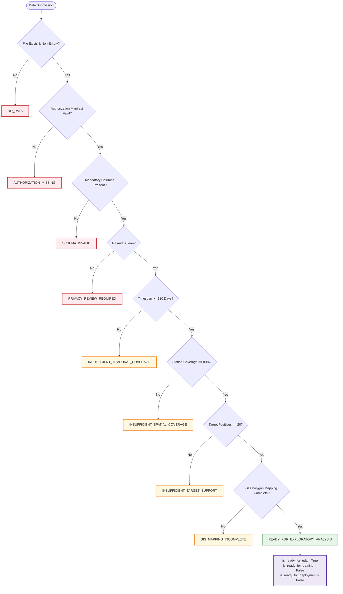

# STRATA RISK — PHASE 4: PUNE AUTHORIZED DATA INTAKE AND MODEL-READINESS GATE
## Controlled Ingestion Contract, Non-Bypassable Readiness Gate, Conservative Geography, Reproducible EDA Workflow, and Baseline Forecasting Protocol

**Document Identifier:** `PUNE_AUTHORIZED_DATA_INTAKE_AND_READINESS.md`  
**Author:** Principal ML Systems Engineer & Geospatial Safety Auditor  
**Date:** October 12, 2026  
**Status:** Phase 4 Implementation Completed — Pune and Mumbai Remain Strictly UNSUPPORTED  
**Scope:** Architectural contract for authorized Pune incident data acquisition, explicit non-bypassable readiness gate, conservative GIS handling, reproducible exploratory analysis workflow, future baseline evaluation protocol, and regression verification.

---

## 1. Executive Summary & Audit Verdict

Phase 4 establishes the formal governance, legal intake contract, and machine-executable data readiness gate required before an authorized historical incident dataset from the Pune City Police Commissionerate can be evaluated.

### Absolute Safety Guarantees Maintained
1. **Zero Model Training or Deployment:** No model was trained, fitted, or deployed for Pune during this phase. Both Pune and Mumbai remain registered with `coverage_status: "UNSUPPORTED"` and `is_validated: False` in [`backend/config/city_config.py`](file:///c:/Users/harsh/Downloads/strata-risk/backend/config/city_config.py#L95-L131).
2. **Zero Synthetic Incidents or Fabricated Geography:** No incident records, coordinates, timestamps, station identifiers, crime labels, or GIS boundaries have been fabricated. When real data is not supplied, the system emits a clean `NO_DATA` status rather than generating synthetic metrics.
3. **Chicago Production Parity & Artifact Immutability:** The deployed Chicago CatBoost model (`forecaster_catboost.cbm`), isotonic calibrator (`calibrator.joblib`), and metadata remain completely untouched. Their SHA-256 cryptographic hashes match their canonical values identically.
4. **Readiness Decoupling:** Readiness for exploratory data analysis (EDA) is strictly decoupled from readiness for model training and readiness for production deployment. Ingestion success does not imply model readiness.

---

## 2. Audit of Existing State & Remediated Inconsistencies

A forensic audit of the pre-Phase 4 codebase revealed discrepancies between the feasibility report ([`PUNE_DATA_QUALITY_AND_FEASIBILITY_REPORT.md`](file:///c:/Users/harsh/Downloads/strata-risk/PUNE_DATA_QUALITY_AND_FEASIBILITY_REPORT.md)) and the actual code:

| Component | Intended Behavior (Report) | Actual Code Behavior (Pre-Phase 4) | Remediated Behavior (Phase 4 Implementation) |
| :--- | :--- | :--- | :--- |
| **Readiness Assessment** | Ingestion success must never imply model training readiness. | [`pune_data_readiness.py`](file:///c:/Users/harsh/Downloads/strata-risk/backend/services/pune_data_readiness.py) set `is_ready_for_training = True` and `readiness_status = "READY"` whenever schema, PII, and station count passed. | Replaced with explicit `PuneDataReadinessGate`. Decoupled `is_ready_for_eda`, `is_ready_for_training` (always `False`), and `is_ready_for_deployment` (always `False`). |
| **Readiness Status Granularity** | Distinguish 9 specific gate failure modes. | Binary `"READY"` vs. `"DEFECTIVE_DATA"` / `"INSUFFICIENT_DATA"`. Ingestion pipeline used arbitrary 500-record threshold for `"INGESTED_PENDING_TRAINING"`. | Implemented canonical [`PuneReadinessStatus`](file:///c:/Users/harsh/Downloads/strata-risk/backend/services/pune_data_readiness.py#L39-L50) enum with 9 non-bypassable sequential states. |
| **Authorization Verification** | Local file presence does not confer legal authorization. | Code assumed that if a CSV file existed at `dataset_path`, it was acquired and authorized. | Implemented [`PuneAuthorizationValidator`](file:///c:/Users/harsh/Downloads/strata-risk/backend/services/pune_data_readiness.py#L190-L245). Requires explicit authorization manifest (`mou_reference`, `is_authorized`, DPDPA certification). Emits `AUTHORIZATION_MISSING`. |
| **Geographic Boundaries vs. Stations** | Official GIS polygons required; unverified bifurcations tracked. | Station counts were audited, but missing GIS shapefiles were ignored by the readiness gate. | Conservative geography audit in gate: tracks unverified bifurcations (`pashan`, `bavdhan`, `alankar`, `wanawadi`) and emits `GIS_MAPPING_INCOMPLETE`. |
| **Representativeness Bias** | Do not silently discard unresolved records without impact analysis. | Coordinates outside Pune bounds were set to NaN without an explicit representativeness impact assessment. | Ingestion and EDA reports track `unresolved_geography_summary`, reporting coordinates missingness and peripheral ward bias impact. |

---

## 3. Authorized Data Intake Contract

The data intake contract ([`PuneIntakeContract`](file:///c:/Users/harsh/Downloads/strata-risk/backend/services/pune_data_readiness.py#L143-L185)) establishes the formal legal, technical, and governance requirements for receiving incident data from the Pune City Police Commissionerate.

### 3.1 Field Schema & Specifications

| Field Name | Type | Presence | Description & Constraints |
| :--- | :--- | :--- | :--- |
| `fir_number_hash` | String (Hex) | **Required** | Pseudonymized SHA-256 or cryptographic hash of FIR number. Irreversible; zero cleartext FIR numbers. |
| `police_station_id` | String | **Required** | Standardized police station identifier matching canonical Pune 33 stations. Unmapped stations are rejected. |
| `incident_datetime` | ISO 8601 String | **Required** | Occurrence timestamp. Parsed in `Asia/Kolkata` (IST). Missing or unparseable timestamps dropped and audited. |
| `section_code` | String | **Required** | IPC or BNS penal section code. Mapped into Strata Risk operational harm tiers. |
| `registration_datetime` | ISO 8601 String | Optional | Timestamp of FIR formal registration. Used to audit reporting lag. |
| `place_of_occurrence` | String | Optional | Beat / chowki description. Strictly screened for citizen PII under DPDPA 2023. |
| `latitude` | Float | Optional | Geocoded latitude. Bound-checked to Pune box ($18.350 \le \text{lat} \le 18.700$). Zero silent imputation. |
| `longitude` | Float | Optional | Geocoded longitude. Bound-checked to Pune box ($73.650 \le \text{lon} \le 74.100$). Zero silent imputation. |

### 3.2 Timezone & Temporal Specifications
- **Canonical Timezone:** `Asia/Kolkata` (IST, UTC+05:30).
- **Daylight Saving Time:** IST does not observe Daylight Saving Time (DST). Timestamps are free from 1-hour temporal discontinuity artifacts.
- **Accepted Formats:** ISO 8601 strings (`YYYY-MM-DDTHH:MM:SS` or `YYYY-MM-DD HH:MM:SS`).
- **Zero Imputation:** Records with null, empty, or unparseable timestamps are dropped and counted in `drop_reasons_breakdown["invalid_or_missing_timestamp"]`.

### 3.3 Station Jurisdictions & Normalization
The dataset must resolve to the 33 administrative police stations of the Pune City Police Commissionerate. Station names are normalized via canonical aliases:
- Trailing suffixes (`Police Station`, `PS`, `Police Stn`) are stripped.
- Transliteration variant `wanawadi` is normalized to `wanowrie`.
- Out-of-jurisdiction stations (e.g. PCMC jurisdictions like `hinjewadi`, `wakad`, `bhosari` transferred to PCMC in 2018) are rejected and counted.

### 3.4 Crime Category & Statutory Mapping
Penal sections are normalized into four operational harm tiers:
1. `violent_street_harm`: IPC 302 (Murder / BNS 103), IPC 307 (Attempt / BNS 109), IPC 392 (Robbery / BNS 309), IPC 397 (Robbery with weapon / BNS 311), IPC 384 (Extortion / BNS 308), IPC 326 (Grievous hurt / BNS 117), chain snatching, dacoity.
2. `property_harm`: IPC 379 (Theft / BNS 303), IPC 380 (Theft in dwelling / BNS 305), IPC 457 (Housebreaking by night / BNS 331), motor vehicle theft, burglary.
3. `public_disorder`: IPC 147 (Rioting / BNS 191), IPC 148 (Armed rioting / BNS 192), unlawful assembly.
4. `other_cognizable`: All other offenses.

### 3.5 Provenance, Authorization & Permitted Use
A dataset is deemed authorized **only if** accompanied by an executed authorization manifest (`authorization_manifest.json` or `<dataset_path>.auth.json`) confirming:
- `mou_reference`: Non-empty agreement identifier (e.g., `MOU/PUNE-COP/2026/STRATA-001`).
- `issuing_authority`: Designated signatory (`Office of Commissioner of Police, Pune City`).
- `permitted_use`: Explicit authorization for public safety modeling and academic evaluation.
- `is_authorized`: Boolean `True`.
- `dpdpa_compliance_certified`: Boolean `True` confirming statutory compliance with the Digital Personal Data Protection Act (DPDPA 2023).

> [!CAUTION]
> **No Local File Assumption:**
> A CSV file residing in a local directory is **never assumed to be authorized**. Without the explicit signed manifest, the intake gate halts immediately with status `AUTHORIZATION_MISSING`.

### 3.6 Data Retention & Deletion Schedule
- **Proposed Retention Period:** 365 calendar days from the date of authorized extraction (**strictly PROPOSED and SUBJECT TO INSTITUTIONAL APPROVAL**; distinct from retrospective historical coverage of ~36 months / 1,080 days).
- **Data Categories Disaggregation:** Disaggregates rules across 8 tiers: raw extracts, cleaned incidents, temporary scratch (0 days), analytical intermediates, aggregated statistical reports (permanent), model-training records (locked disabled), audit manifests (permanent), and encrypted backups.
- **Storage Enclave:** Encrypted storage at rest (AES-256) in an access-controlled enclave. Zero public cloud upload.
- **Sanitization Protocol:** NIST SP 800-88 Rev. 1 media sanitization / overwriting upon project conclusion or authority request. On standard filesystems, application unlinks files; real data deletion requires manual confirmation and institutional authorization (no automated background deletion daemon).

### 3.7 PII Screening & Rejection Behavior
- **Column Screening:** Rejection on matching `PROHIBITED_PII_FIELDS` (`complainant_name`, `victim_name`, `accused_name`, `suspect_name`, `phone_number`, `aadhaar_number`, `pan_number`, `residential_address`, `witness_name`, `caste`, `religion`).
- **Vectorized Content Scanning:** Vectorized regex inspection across 100% of rows for 10-digit mobile numbers (`\b[6-9]\d{9}\b`), email addresses, 12-digit Aadhaar numbers, and 10-character PAN cards.
- **Zero Value Echoing:** Exceptions and audit reports state the column name and violation pattern without echoing private citizen values.

---

## 4. Explicit Data-Readiness Gate Architecture

The [`PuneDataReadinessGate`](file:///c:/Users/harsh/Downloads/strata-risk/backend/services/pune_data_readiness.py#L249-L440) enforces a sequential, non-bypassable state machine across 9 discrete statuses:



### Readiness Status Transition Matrix

| Gate Status | Trigger Condition | Blockers / Action Required |
| :--- | :--- | :--- |
| `NO_DATA` | File path is `None`, file does not exist, or dataframe has 0 rows. | Provide a non-empty dataset path. |
| `AUTHORIZATION_MISSING` | Manifest missing, `is_authorized: False`, or `mou_reference` blank. | Execute formal MoU with Pune City Police Commissionerate. |
| `SCHEMA_INVALID` | Missing required fields (`fir_number_hash`, `police_station_id`, `incident_datetime`, `section_code`). | Standardize database export to expected CCTNS schema. |
| `PRIVACY_REVIEW_REQUIRED` | Column matching prohibited list or regex detecting phone/email/Aadhaar/PAN. | Redact citizen PII before ingestion enclave. |
| `INSUFFICIENT_TEMPORAL_COVERAGE` | Dataset timespan < 180 days (for EDA) or < 1,080 days (for modeling). | Extract minimum longitudinal depth (36 months for models). |
| `INSUFFICIENT_SPATIAL_COVERAGE` | Covers < 80% of authorized police stations (< 26 of 33 stations). | Ensure comprehensive commissionerate-wide extraction. |
| `INSUFFICIENT_TARGET_SUPPORT` | Positive cases in forecast evaluation window < 20 (EDA) or < 100 (models). | Verify penal section coverage or lengthen evaluation horizon. |
| `GIS_MAPPING_INCOMPLETE` | Official GIS shapefile unprovided or unverified bifurcations unmapped. | Acquire official municipal police boundary shapefile from CoP/PMC. |
| `READY_FOR_EXPLORATORY_ANALYSIS` | All 8 preliminary gates pass cleanly. | Proceed to offline exploratory data analysis. **Zero model training.** |

---

## 5. Conservative Geography Handling

Strata Risk adheres to conservative geographic governance:
1. **Zero Boundary Inference:** Police station jurisdictional polygons are never inferred from point coordinates, station addresses, or convex hulls.
2. **Explicit Tracking of Unresolved Records:** Records lacking valid coordinates or belonging to unverified recent bifurcations (`alankar`, `pashan`, `bavdhan`, `wanawadi`) are tracked explicitly in `unresolved_geography_summary`.
3. **No Silent Attrition:** Geographically unresolved records are **never silently discarded**. Discarding them would bias spatial models against rapidly expanding suburban peripheral wards where geocoding infrastructure is nascent.

---

## 6. Reproducible Exploratory Analysis (EDA) Workflow

The [`PuneExploratoryAnalysisWorkflow`](file:///c:/Users/harsh/Downloads/strata-risk/backend/services/pune_data_readiness.py#L485-L665) provides a standardized, reproducible diagnostic suite that runs once an authorized dataset is supplied.

### 6.1 Diagnostic Output Profiles
- **Temporal Profile:** Date range, timespan in days, record counts per month, and identification of temporal gaps (months with zero filings).
- **Station Profile:** Incident distribution per police station and coverage percentage across the 33 jurisdictions.
- **Category Profile:** Cross-tabulation of harm tiers over calendar months, tracking longitudinal category shifts.
- **Data Quality Profile:** Counts of missing timestamps, unparseable dates, and missing station identifiers.
- **Deduplication Profile:** Counts of exact duplicate rows, cross-station Zero FIR transfers, and amended filing timestamps.
- **Spatial Profile & Unresolved Geography:** Coordinate completeness percentage and representativeness impact assessment.
- **Target Support by Forecast Window:** Positive event counts across 4-hour, 8-hour, and 24-hour shift intervals.
- **Recording Practice Shifts:** Flags the July 1, 2024 statutory transition from the Indian Penal Code to the Bharatiya Nyaya Sanhita (BNS).

### 6.2 Strict No-Data & Fixture Behavior
- If `dataset_path=None` or the file does not exist, the workflow emits `status: "NO_DATA"` with `eda_report: None`. It never fabricates placeholder distributions.
- If called on a unit test fixture, the workflow requires `is_fixture=True` and tags the report as `"FIXTURE_EVALUATION"`, preventing test data from being mistaken for real-world statistics.

---

## 7. Future Forecasting Evaluation Protocol

The [`PuneForecastingEvaluationProtocol`](file:///c:/Users/harsh/Downloads/strata-risk/backend/services/pune_data_readiness.py#L670-L745) documents the prediction unit, forecast horizon, baseline progression, and evaluation metrics required before any model can be trained:

### 7.1 Prediction Unit & Forecast Horizon
- **Spatio-Temporal Unit:** Police Station Jurisdiction ($S_i$, $i \in \{1 \dots 33\}$) $\times$ 4-Hour Operational Shift Window ($W_j$, 6 shifts/day).
- **Forecast Horizon:** 4 Hours Ahead. Predicts incident occurrence during shift $t+1$ using features strictly observed up to shift $t$.
- **Target Variable:** Binary occurrence $Y_{i, t+1} \in \{0, 1\}$ of target harm incidents in station $i$ during shift $t+1$.

### 7.2 Benchmark Baseline Progression Hierarchy
Before evaluating any machine-learning model (such as CatBoost), Strata Risk requires establishing three local empirical baselines:

```
+-----------------------------------------------------------------------------------------+
|                         HIERARCHY OF BENCHMARK FORECASTERS                              |
+-----------------------------------------------------------------------------------------+
|                                                                                         |
|  Level 1: Historical Station-Level Rate                                                 |
|  └── Computes empirical base rate per police station: P_hat(Y=1 | station)               |
|  └── Stationary benchmark computed across training partitions.                          |
|                                                                                         |
|  Level 2: Time-Aware Expanding Historical Rate                                          |
|  └── Computes expanding-window rate strictly prior to forecast time t:                   |
|      P_hat(Y=1 | station, t) = (1 / (t - t_0)) * sum_{tau=t_0}^{t-1} Y_{station, tau}   |
|                                                                                         |
|  Level 3: Cyclical Spatio-Temporal Baseline                                             |
|  └── Incorporates diurnal shift-of-day (4h windows) and day-of-week interactions:        |
|      P_hat(Y=1 | station, shift_window, day_of_week)                                    |
|                                                                                         |
|  Level 4: CatBoost Spatio-Temporal Classifier with Platt / Isotonic Calibration         |
|  └── Evaluated ONLY after Levels 1-3 are established.                                   |
|  └── Must demonstrate statistically significant improvements in both:                   |
|      - Probability calibration: Brier score, Log loss, ECE.                             |
|      - Operational Hotspot Ranking: Precision@K and Recall@K on holdout shifts.        |
|                                                                                         |
+-----------------------------------------------------------------------------------------+
```

> [!IMPORTANT]
> **No Outperformance Guarantee:**
> CatBoost is **not assumed or promised** to outperform simpler baselines. In sparse spatio-temporal regimes where base rates are low ($< 5\%$), empirical priors and regularized cyclical baselines often exhibit superior calibration and robustness compared to complex tree ensembles.

### 7.3 Multi-Metric Evaluation Framework
- **Probability Quality:**
  - **Brier Score:** $\text{BS} = \frac{1}{N} \sum_{k=1}^N (p_k - y_k)^2$.
  - **Binary Cross-Entropy (Log Loss):** Penalizes confident mispredictions.
  - **Expected Calibration Error (ECE):** Evaluates reliability curves across deciles.
- **Hotspot Ranking Quality:**
  - **Precision@K ($K=3, 5$):** Proportion of top-$K$ prioritized stations experiencing target incidents.
  - **Recall@K ($K=3, 5$):** Proportion of total shift incidents captured within top-$K$ prioritized stations.
- **Uncertainty Quantification:** Moving Block Bootstrap (MBB) preserving temporal autocorrelation to construct 95% confidence intervals.

---

## 8. Test Verification & Regression Protection

### 8.1 Test Suite Results
A comprehensive test suite was executed across the full backend stack:

| Test Module | Coverage Dimension | Tests | Status |
| :--- | :--- | :---: | :---: |
| [`test_pune_data_readiness_gate.py`](file:///c:/Users/harsh/Downloads/strata-risk/backend/tests/test_pune_data_readiness_gate.py) | Phase 4 Gate: `NO_DATA`, `AUTHORIZATION_MISSING`, `SCHEMA_INVALID`, `PRIVACY_REVIEW_REQUIRED`, `INSUFFICIENT_TEMPORAL_COVERAGE`, `INSUFFICIENT_SPATIAL_COVERAGE`, `INSUFFICIENT_TARGET_SUPPORT`, `GIS_MAPPING_INCOMPLETE`, non-bypassability, active safety, EDA workflow, and protocol hierarchy. | **15** | **PASSED** |
| [`test_pune_data_ingestion.py`](file:///c:/Users/harsh/Downloads/strata-risk/backend/tests/test_pune_data_ingestion.py) | Phase 2 & 3: CCTNS schema parsing, deduplication edge cases, PII scanning, alias normalization, anti-leakage splitting, and representativeness tracking. | **28** | **PASSED** |
| [`test_india_first_architecture.py`](file:///c:/Users/harsh/Downloads/strata-risk/backend/tests/test_india_first_architecture.py) | Multi-city registry, boundary resolution, honest readiness reporting, and coordinate resolution. | **8** | **PASSED** |
| [`test_universal_location.py`](file:///c:/Users/harsh/Downloads/strata-risk/backend/tests/test_universal_location.py) | Location search, reverse geocoding, boundary resolution, and API safety gating. | **15** | **PASSED** |
| Core Pipeline & Baselines | Chicago benchmarks, calibration, models, and data pipeline tests. | **43** | **PASSED** |
| **Total Backend Test Suite** | `python -m pytest backend/tests/ -v` | **109** | **PASSED (0 failures)** |

### 8.2 Frontend & Build Verification
- **TypeScript Compilation:** `npx tsc --noEmit` exited with **0 errors**.
- **Frontend Linter:** `npm run lint` exited with **0 errors, 0 warnings**.
- **Production Build:** `npm run build` generated `dist/` cleanly in 306ms.

### 8.3 Chicago Artifact Cryptographic Immutability
The Chicago forecaster, calibrator, and metadata were verified against their canonical SHA-256 hashes:

| Artifact | File Path | Verified SHA-256 Hash | Status |
| :--- | :--- | :--- | :---: |
| **Calibrator** | `backend/artifacts/calibrator.joblib` | `8646328A284D513B7DB78967BFF660EA9A8DD174372DA109CF8DEF3D31C2594D` | **MATCH (Unchanged)** |
| **Forecaster** | `backend/artifacts/forecaster_catboost.cbm` | `8A9FF0EC1D7EF8E5D60EEECA633C40EBAB423CE9CAD7A241CC45F2BEEFAC4A96` | **MATCH (Unchanged)** |
| **Metadata** | `backend/artifacts/model_metadata.json` | `B7A3A06EF6B823D0D87E93011E7AFCF07710A84AE13D94784761917643EDA407` | **MATCH (Unchanged)** |

---

## 9. Remaining Blockers & Pre-Training Dependencies

Before any model training or exploratory analysis on real Pune incidents can proceed, the following institutional prerequisites must be satisfied:

1. **Executed Institutional MoU:** Execution of a formal Memorandum of Understanding with the **Office of the Commissioner of Police (CoP), Pune City**, containing a DPDPA 2023 Data Protection Annexure and permitted-use clause.
2. **Longitudinal Extract:** Provision of an anonymized CCTNS database export covering a minimum of 36 continuous months ($N \ge 15,000$ incidents) to allow stable spatio-temporal modeling and out-of-time holdouts.
3. **Official GIS Boundary Shapefile:** Provision of verified digital boundary polygons (Shapefile or GeoJSON) for all 33 police station jurisdictions from the Pune City Police / PMC Town Planning Department, specifically clarifying the recent bifurcations (`pashan`, `bavdhan`, `alankar`, `wanawadi`).
4. **On-Premise Secure Enclave:** Deployment of the ingestion and training workflow inside an air-gapped, encrypted police computing environment to ensure zero citizen data transmission.
